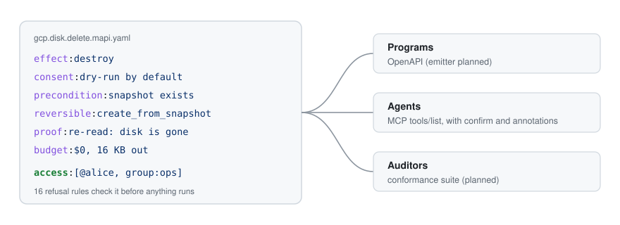

<div align="center">

# MAPI

**One contract for a capability, readable by programs (API), agents (MCP) and auditors.**
**Um contrato para uma capacidade, legível por programas (API), agentes (MCP) e auditores.**

[](https://github.com/thiagopatzdorf/MAPI/actions/workflows/test.yml)
[](LICENSE)




</div>

OpenAPI describes what a program can call. MCP describes what an agent can call. Both stop at
*"what can I call"*. Neither says what happens next: whether it changes state, how to undo it,
what it costs, who had to consent, **how to prove it worked**, and **who is allowed to call it at all**.

MAPI is a thin layer **on top of** OpenAPI and MCP. It does not compete with them; it compiles to them.

| field | meaning |
|---|---|
| `effect` | read / write / destroy (+ idempotency) |
| `consent` | dry-run by default; explicit confirm to act |
| `reversible` | the inverse operation, **required** for writes, or an explicit `irreversible.reason` |
| `precondition.evidence` | for destructive ops: proof that it can be rebuilt, checked **before** destroying |
| `proof` | an independent re-read of the *state* after the call ("sent" is not "delivered") |
| `budget` | cost per call, max output size, max duration |
| `access` | **who** may call it, as identities that resolve to public keys (new in v0.1, SPEC §2.2) |

## Access is all-or-nothing today. It shouldn't be.

Most systems answer "who can call this?" with "whoever holds the token", the same 100%-or-0% that
Git has with files. A MAPI contract names the callers, and every name must turn into a public key:

```yaml
capability: gcp.disk.delete
effect: destroy
access:
  callers: ["@alice", "group:ops", "age1…"]   # GitHub user, group, or a key for a machine/agent
  data: { at_rest: encrypted }               # what it stores is encrypted to those keys
```

`@alice` means the SSH keys GitHub publishes at `github.com/alice.keys`, pinned when she is added.
The first enforcement already ships: **[git selo](https://github.com/thiagopatzdorf/git-selo)**
encrypts files inside a normal Git repo to exactly those keys (age format; `.env` committed safely).
MCP filtering (`tools/list` per caller) and signed HTTP calls are specified but not implemented yet.

## Try it

```sh
pip install "git+https://github.com/thiagopatzdorf/MAPI"
mapi check examples/receita_apagar.mapi.yaml        # exit 0: passes every rule
mapi build --mcp examples/receita_apagar.mapi.yaml  # emits the MCP tools/list
```

A destroy without a caller list, and one with a name that is not a key (real output; rule messages
are in Portuguese, the contract fields are English):

```console
$ mapi check no-access.mapi.yaml
[{"rule": "R16", "capability": "gcp.disk.delete", "path": "$.access",
  "message": "write/destroy sem access: diga quem pode chamar"}]          # exit 2
$ mapi check admin.mapi.yaml
[{"rule": "R17", "capability": "gcp.disk.delete", "path": "$.access.callers[0]",
  "message": "caller 'admin' não se resolve para chave: use @usuario, group:nome, age1… ou ssh-ed25519/ssh-rsa"}]
```

## Honest status

- **Exists and is tested:** the loader, **16 refusal rules** (R1–R14, R16, R17; R15 is about flows
  and is not implemented), and the **MCP emitter**, checked by invariants (valid schema, `$ref`
  resolves, annotations consistent with `effect`, `confirm` iff consent) and by 5 of 5 deliberate
  mutations of the emitter caught. ~200 tests.
- **Not yet:** the OpenAPI emitter, the OpenAPI → MAPI importer, the generated conformance suite.
  The `examples/*.openapi.yaml` files are hand-written design sketches, not compiler output, and
  our own evaluator found that two of the three are not valid OpenAPI. That is exactly why the
  emitter is judged by invariants and not by hand-written expected files.
- 13 of the rules were written by an open-weights coding agent for **US$ 2.11 in total**, each
  accepted only after a robustness evaluator passed; the first round without that evaluator got
  1 of 3 right.
- Our survey estimates ~45% of the idea already exists elsewhere (effect/idempotency hints in MCP
  and Smithy, flows in Arazzo). What we found missing: mandatory inverse, state-based proof,
  evidence-before-destroy, behavioural conformance, and caller lists that resolve to keys. If you
  know prior art for those, an issue is the most useful contribution.

## Layout

- [SPEC.md](SPEC.md): data model, refusal rules, mapping to OpenAPI and MCP.
- [mapi/](mapi/): reference compiler (`mapi/regras/rNN_*.py`, one rule per file, each with a test).
- [examples/](examples/): three real contracts from a production system.
- [docs/research.md](docs/research.md): state of the art, with sources and dates.

## License

Apache-2.0, see [LICENSE](LICENSE).
